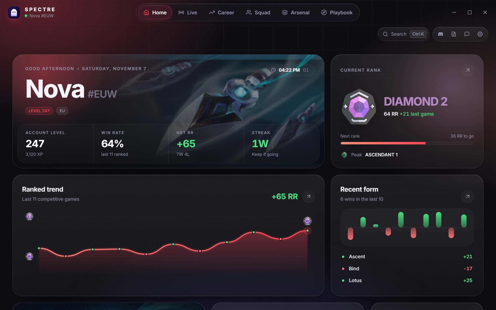
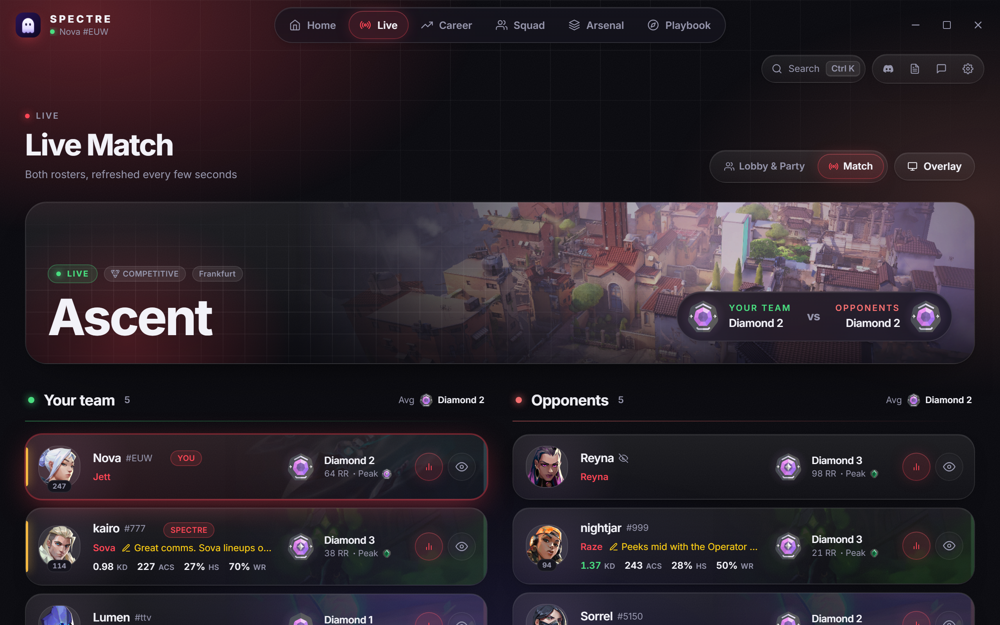
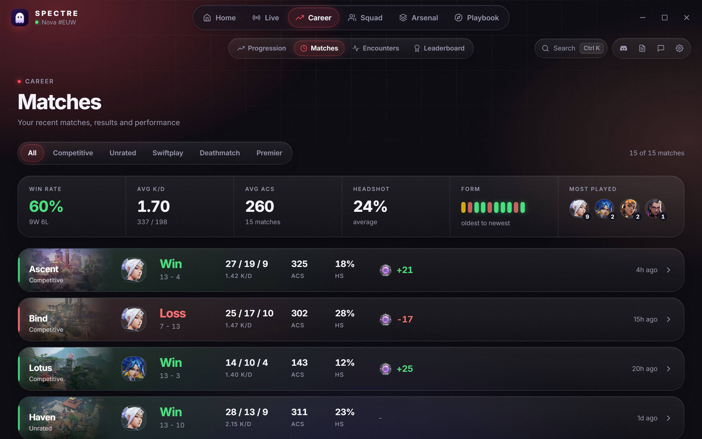
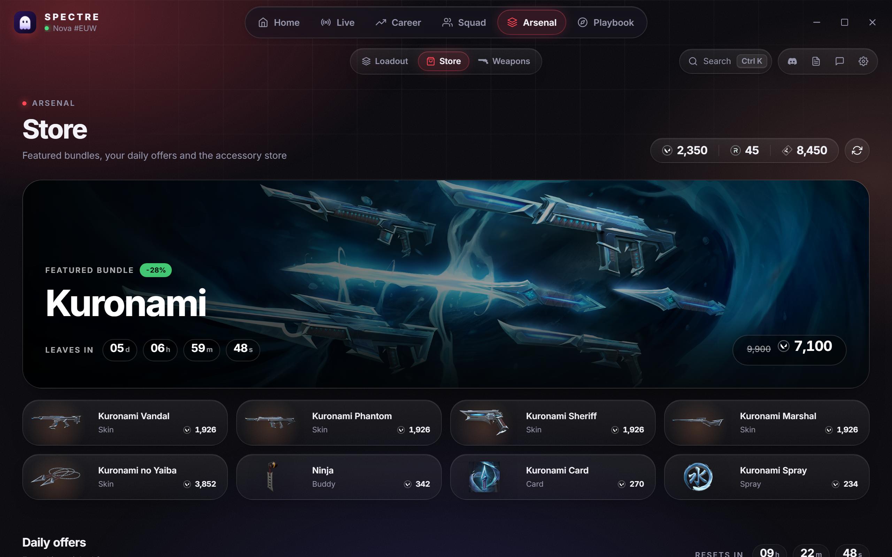
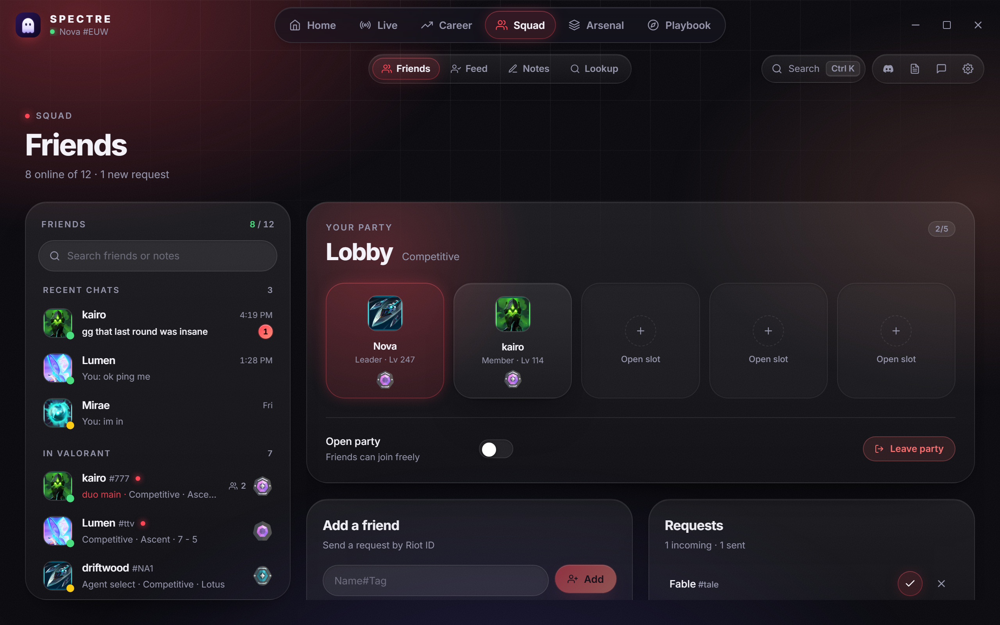
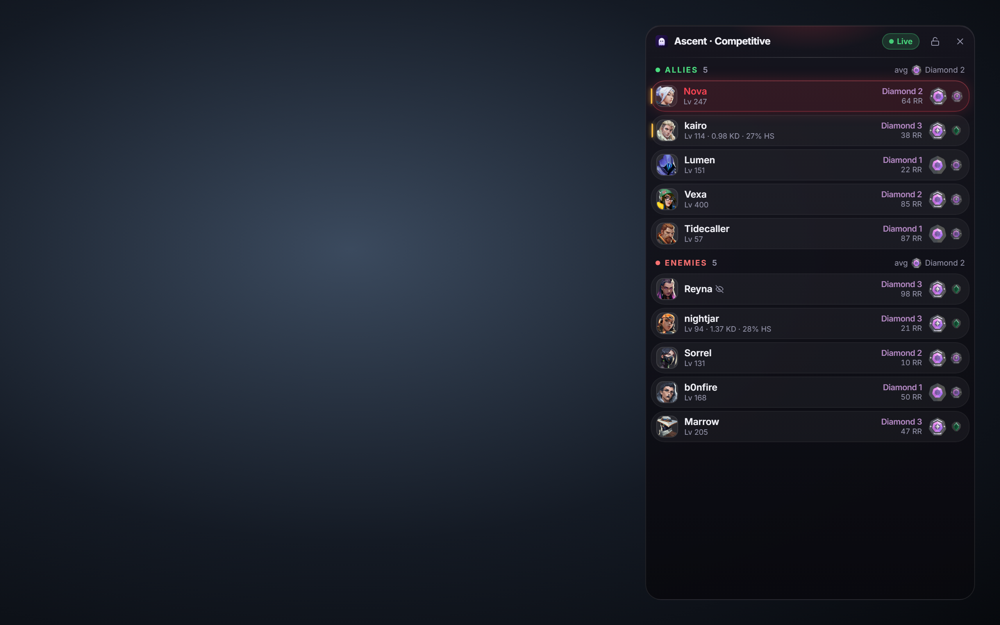
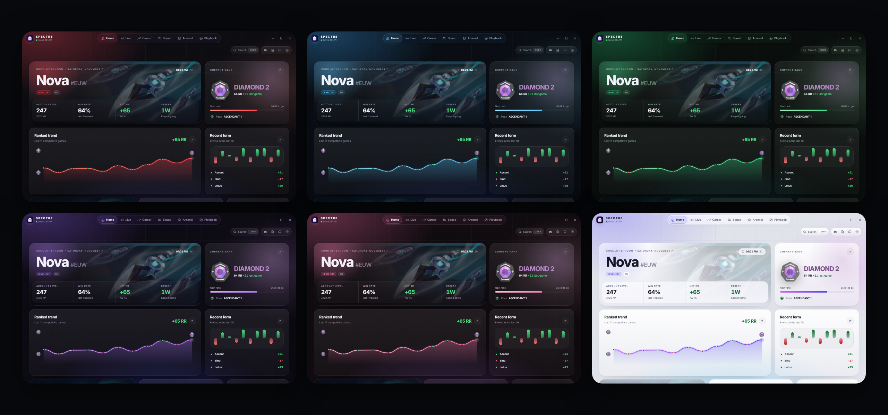

<div align="center">


# Spectre

**👻 A sleek desktop companion for VALORANT on Windows**

Live match ranks, scouting, skins, your party, Discord presence and more, all through the Riot Client you're already signed in to.

[](https://github.com/booomxd/spectre/releases/latest)
[](https://github.com/booomxd/spectre/releases)


**[🌐 Website](https://spectreclient.pages.dev/)** · **[⬇️ Download](https://github.com/booomxd/spectre/releases/latest)** · **[✨ Features](docs/FEATURES.md)** · **[🔒 Privacy](docs/PRIVACY.md)** · **[🛠️ Development](docs/DEVELOPMENT.md)** · **[📜 Changelog](CHANGELOG.md)**

</div>

---

> [!NOTE]
> Spectre is an independent, open-source fan project. It isn't made or endorsed by Riot Games and is provided as is, without warranty.

## ✨ Highlights

| | |
| --- | --- |
| 🎯 **Live Match** | Every player's current-act rank, RR and peak, their skins, premade party tags, and a one-click **Scout** with rank history, recent form and matches. |
| 👥 **Lobby & Party** | Invite friends, share invite codes, pick a mode, ready up and start matchmaking without opening the game. |
| 🔫 **Skins** | See anyone's loadout in a match, and change your own skins right from agent select. |
| 🎮 **Discord presence** | "Playing Spectre" with your mode, map art, score, rank and party, all fully customizable. |
| 🕶️ **Streamer-safe** | Players who hide their name in your match stay hidden everywhere in Spectre (except you and friends in your party). No names, IDs or cards. |
| 🖥️ **In-game overlay** | Both teams' ranks over the game, toggled with a hotkey, with optional click-through and auto-show. |
| ⬆️ **Auto updates** | New versions show up in the app and install in one click. |
| 🪟 **Stays out of the way** | Starts with Windows in the tray, and closing keeps it running in the hidden icons. |
| 🎨 **Sixteen glass themes** | Midnight, Onyx, Ember, Glacier, Verdant, Amethyst, Gilded, Aurora, Sakura, Abyss, Sunset, the light Pearl, plus Frutiger Aero, Vaporwave, Y2K Chrome and Lo-fi. |

## 📸 Preview

<p align="center">
  <a href="docs/screenshots/home.png"></a>
</p>

| 📡 Live match | 🔍 Scout any player |
| :---: | :---: |
| [](docs/screenshots/live.png) | [](docs/screenshots/scout.png) |

| 🕑 Matches | 🛒 Store |
| :---: | :---: |
| [](docs/screenshots/matches.png) | [](docs/screenshots/store.png) |

| 👥 Squad | 🖥️ In-game overlay (<code>Ctrl+Shift+O</code>) |
| :---: | :---: |
| [](docs/screenshots/squad.png) | [](docs/screenshots/overlay.png) |

<p align="center">
  <a href="docs/screenshots/themes.png"></a>
</p>

<sub>Screenshots use sample data: the players, names and stats are made up. Streamer-mode players show only their agent, just like in a real match.</sub>

## ⬇️ Download

Grab the latest version from **[Releases](https://github.com/booomxd/spectre/releases/latest)**:

| File | What it is |
| --- | --- |
| 📦 `Spectre-x.y.z-setup.exe` | Installer. One click, installs for your user only, adds a desktop shortcut. |

**Requirements:** Windows 10 or 11 (64-bit), VALORANT installed, and the Riot Client open and signed in.

> [!TIP]
> Spectre isn't code-signed, so Windows SmartScreen may warn on first launch. Click **More info**, then **Run anyway**.

## 🧭 What's inside

| Section | Pages |
| --- | --- |
| 🏠 **Home** | Rank, RR, wallet, battle pass, daily offers and online friends |
| 🔴 **Live** | Live Match with party tags, Lobby & Party, Scout, Skins and an always-on-top overlay |
| 📊 **Career** | Progression · Matches · Encounters · Leaderboard |
| 👥 **Squad** | Friends & chat · Feed · Notes · Lookup |
| 🎒 **Arsenal** | Loadout · Store & Night Market · Weapons |
| 🗺️ **Playbook** | Strategy board with maps, agents, abilities and saved playbooks |
| ⚙️ **Dock** | Discord · What's new · Feedback · Settings (with an opt-in **Experimental** tab) · Ctrl+K quick search |

Every page is explained in **[docs/FEATURES.md](docs/FEATURES.md)**.

## 🔒 Privacy

- 🔑 No Riot password and no accounts: Spectre uses the Riot Client session already on your PC.
- 📡 No servers of its own, no analytics, no telemetry.
- 👻 Streamer-mode players in your match are never named or identified.
- 💾 Your settings and notes stay in `%APPDATA%\Spectre`.

Details in **[docs/PRIVACY.md](docs/PRIVACY.md)**.

## 🛡️ Safety

Spectre is **not a cheat** and never touches the game itself.

- 🚫 No reading or changing game memory or files, and nothing injected.
- 🧱 No contact with Vanguard: it's a regular desktop app.
- 🔌 It talks to Riot the same way the VALORANT client does, using your own signed-in session.
- 👀 It only changes things when you ask, like equipping a skin or inviting a friend.

> [!NOTE]
> Spectre is unofficial and not affiliated with Riot Games 💜

## 🛠️ Build from source

```bash
npm install
npm run app          # run with hot reload
npm run app:build    # installer in src-tauri/target/release/bundle/nsis/
```

Requires Node.js 18+, Rust (stable, MSVC) and WebView2. Architecture, the backend test helper and the release process are in **[docs/DEVELOPMENT.md](docs/DEVELOPMENT.md)**.

## ❓ FAQ

<details>
<summary><b>Spectre says it's waiting for the Riot Client</b></summary>

Open the Riot Client and sign in. Spectre connects on its own within a few seconds.
</details>

<details>
<summary><b>Live Match is empty</b></summary>

It fills in once agent select starts. Before that, the Lobby & Party tab in Live shows your party.
</details>

<details>
<summary><b>My Experimental profile edits disappeared</b></summary>

VALORANT resets your presence when your party, queue or match changes. Turn on <b>Keep applied</b> and Spectre re-sends your edits automatically.
</details>

<details>
<summary><b>How do I quit Spectre completely?</b></summary>

Closing the window keeps Spectre in the hidden tray icons. Right-click its tray icon and choose <b>Quit</b>, or turn off <b>Close to tray</b> in Settings.
</details>

<details>
<summary><b>How do I uninstall?</b></summary>

Windows Settings → Apps → Installed apps → Spectre. To remove saved data too, delete <code>%APPDATA%\Spectre</code>.
</details>

## ⚖️ Legal

Spectre was created under Riot Games' "Legal Jibber Jabber" policy using assets owned by Riot Games. Riot Games does not endorse or sponsor this project. VALORANT and Riot Games are trademarks or registered trademarks of Riot Games, Inc.

<div align="center">

Made with 👻 by <a href="https://github.com/booomxd">booomxd</a>

</div>
